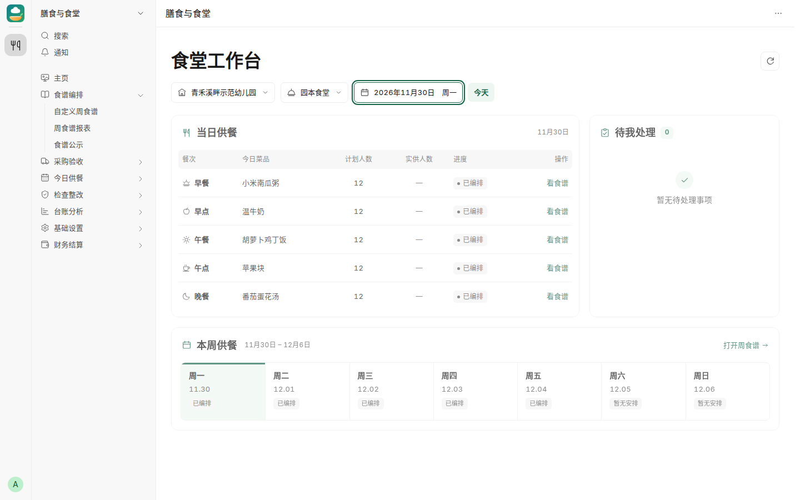

<p align="center">
  
</p>

<h1 align="center">童健云 · Tongjianyun</h1>

<p align="center"><strong>面向幼儿园的开源管理应用，支持自托管。</strong></p>

<p align="center">
  园长、保健员和食堂团队可以在同一套系统里编排带量周食谱、核算采购、验收食材、记录供餐和查询台账。
</p>

<p align="center">
  <a href="https://github.com/jerry317395616/tongjianyun/releases/download/v2.0.1/tongjianyun-canteen-demo.mp4"><strong>观看 90 秒演示</strong></a>
  · <a href="#开始使用">开始使用</a>
  · <a href="https://github.com/jerry317395616/tongjianyun/releases/latest">下载发布版</a>
  · <a href="CONTRIBUTING.md">参与贡献</a>
  · <a href="#联系我们">联系我们</a>
</p>

<p align="center">
  <a href="https://github.com/jerry317395616/tongjianyun/actions/workflows/checks.yml?query=branch%3Adevelop"></a>
</p>



## 一份食谱如何走到采购和供餐

青禾溪畔示范幼儿园计划给 12 名幼儿供应小米南瓜粥。配方中的小米用量为每人 22 克，系统汇总出 264 克需求。班级人数、配方用量和账面库存一起作为采购申请的依据。用同一周食谱还可以安排供餐、查看带量报表和追溯执行记录。[查看示范园操作步骤](docs/meal-demo.md)

| 环节 | 可以完成的工作 |
| --- | --- |
| 标准菜品与食材 | 维护食材别名、计量单位和营养档案。按每份用量维护菜品配方并审核发布。 |
| 周食谱编排 | 按供餐周历安排菜品，从在园名册取计划人数，按餐调整食材用量。 |
| 采购与验收 | 核对需求和库存，生成采购申请，跟踪供应商配送、验收和食材批次。 |
| 供餐与食品安全 | 记录逐餐供餐、厨房日结、食品留样、陪餐和检查整改。 |
| 台账与分析 | 按园所、食堂和日期查询执行记录，查看周食谱、库存、采购和结算报表。 |

## 开始使用

### 先看演示

[十分钟试用指南](docs/meal-demo.md)包含食堂工作台、周食谱表和采购申请截图。想亲手编排食谱，可按[搭建演示站点](docs/install.md#建立可交互的演示站点)在本机创建独立环境。初始化脚本会生成虚构园所、五天 25 餐、关联采购申请和食品安全检查记录。

### 安装到自己的 Bench

当前验证基线为 Frappe 17、ERPNext 17 的固定开发版本，以及配套的 Frappe Education 版本。主机依赖和精确的上游提交见[安装与升级文档](docs/install.md)。

在已经安装并核对 ERPNext 与 Education 版本的 Bench 中运行。将示例站点名 `kindergarten.example.test` 换成自己的站点。以下命令以 `v2.0.1` 为例。

```bash
bench get-app --branch v2.0.1 https://github.com/jerry317395616/tongjianyun.git
bench --site kindergarten.example.test install-app tongjianyun
bench build --app tongjianyun
```

安装完成后，在 Desk 打开 **膳食与食堂**。

## 如何与 Frappe 生态配合

- **Frappe Framework** 提供 Desk、表单、角色和访问权限。园所可以按岗位配置账号可访问的范围。
- **ERPNext** 保管物料、BOM、采购和库存单据。标准食材复用物料，菜品配方复用 BOM。
- **Frappe Education** 提供学年、学期和在读班级名册。童健云据此计算计划供餐人数，并管理食谱、食堂和供餐流程。

食材营养档案可录入每 100 克的营养值。周食谱报表和可选的 AI 营养估算有各自的配置和数据说明。[食谱报表与营养分析](docs/meal-reports.md)

## 项目与社区

- [变更记录](CHANGELOG.md)汇总已发布功能，[项目路线图](docs/roadmap.md)列出接下来的验收目标。
- 欢迎贡献代码、中文文档和可复现的业务案例。一般问题和功能建议可提交到 [GitHub Issues](https://github.com/jerry317395616/tongjianyun/issues)。[贡献指南](CONTRIBUTING.md)
- 安装、迁移、演示单据和跨园所权限随代码自动检查。发现疑似越权或其他漏洞时，可通过私密渠道报告。[自动化检查](https://github.com/jerry317395616/tongjianyun/actions/workflows/checks.yml) · [安全报告指南](SECURITY.md)

## 联系我们

园所试用和部署咨询请添加微信 `so342910289`。

## 许可证

童健云原创代码采用 [MIT 许可证](license.txt)。上游应用和依赖按各自许可证分发。[第三方软件说明](docs/third-party.md)

## English overview

Tongjianyun is a self-hosted, open-source kindergarten management application built on Frappe, ERPNext, and Frappe Education. Its canteen module connects portioned weekly menus with purchasing, receiving, meal service, and traceable records. See the [demo walkthrough](docs/meal-demo.md) and [installation guide](docs/install.md) for a reproducible setup.
