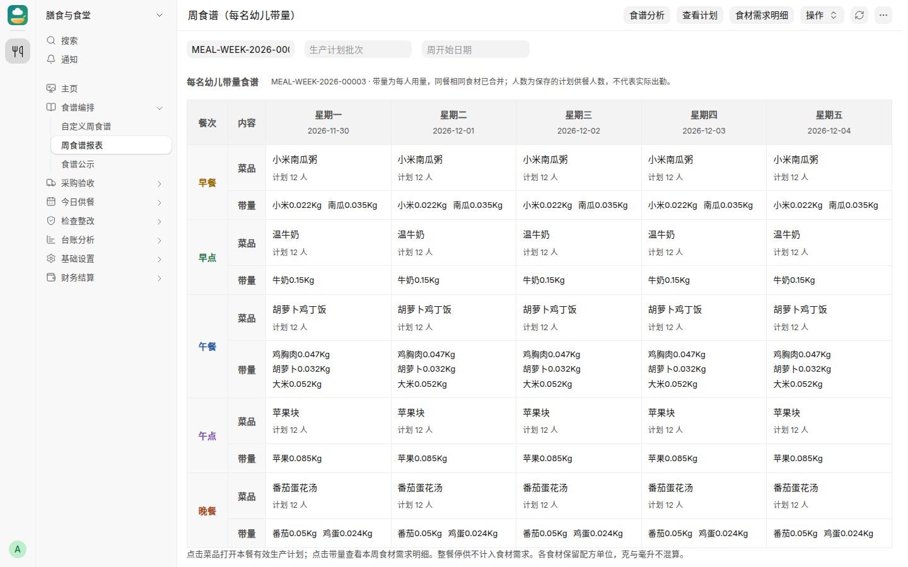
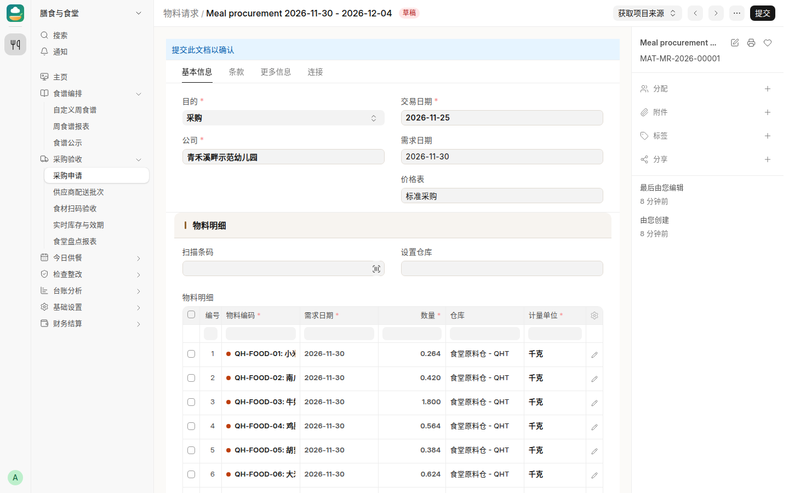

# 十分钟了解膳食与食堂

以下演示使用虚构的「青禾溪畔示范幼儿园」。安装步骤见[搭建可交互的演示](install.md#建立可交互的演示站点)。脚本会在站点的下一供餐周生成 12 人、五天共 25 餐的带量食谱和关联采购申请，同时准备当日食品安全检查记录。

[查看 90 秒演示视频](https://github.com/jerry317395616/tongjianyun/releases/download/v2.0.1/tongjianyun-canteen-demo.mp4)。视频依次展示食堂工作台、带量周食谱和采购申请。

| 顺序 | 从「膳食与食堂」打开 | 观察内容 |
|---|---|---|
| 1 | 食谱编排 → 自定义周食谱 | 选择青禾溪畔，查看已审核的食谱和供餐周历。打开午餐，核对胡萝卜鸡丁饭的每份用量与人数。 |
| 2 | 食谱编排 → 周食谱报表 | 选择演示周，查看每日餐次和食材带量，可下载表格。 |
| 3 | 采购验收 → 采购申请 | 打开与周食谱关联的采购申请，检查数量和需求日期。真实业务可接着下单、登记配送批次并验收。 |
| 4 | 检查整改 → 食品安全检查 | 查看已完成的当日检查，练习把异常纳入整改跟踪。 |
| 5 | 台账分析 → 膳食台账 | 打开园所和日期筛选，了解如何查询采购、供餐、留样等业务记录。 |

采购到货后，可进入「采购验收」登记验收并追踪批次，再进入「今日供餐」处理领用、日结与留样。演示中的材料和用量仅供操作练习。演示编排员和受限账号供自动测试验证角色与园所范围，由站点管理员管理可登录的试用账户。

## 演示界面

